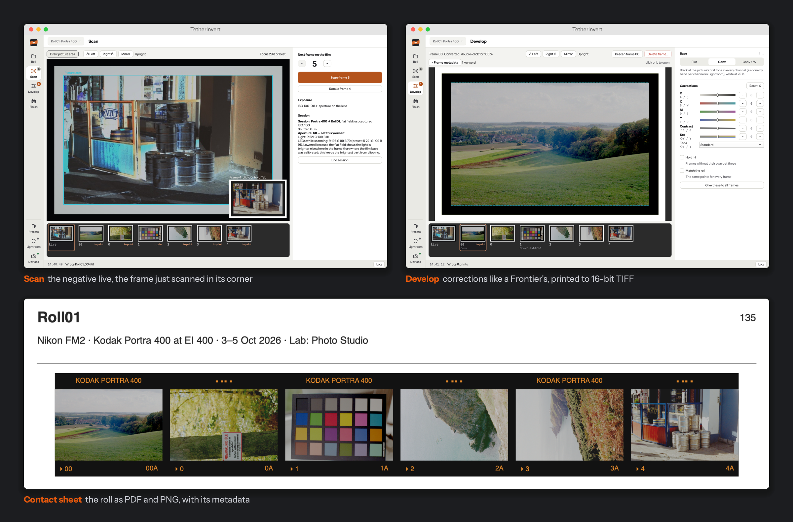

<p align="center"></p>

# TetherInvert

Tethered film scanning and conversion, built around single-channel RGB (Trichomatic) and tethered scanning: fast, simple,
calibrated.



TetherInvert drives a digital camera on a copy stand and a [Scanlight](https://github.com/jackw01/scanlight)
(or a light you set by hand), shoots each negative under red, green and blue light one after the
other, and writes 16-bit TIFFs: a calibrated, repeatable starting point for every frame of a roll.

More lights with an open API will follow as testers are available.

Finish them in Lightroom Classic or any editor, or develop and print them in TetherInvert.

TetherInvert is tailored around a tethered camera connection. This allows for a rapid workflow and instant conversion results.

- **Calibration per film stock:** the film base exposed to the right in every channel, which sets
  the white balance.
- **A flat field per session** against uneven light.
- **A flat master per frame**, plus optional prints developed with corrections modelled on the
  Frontier SP-3000's controls.
- **Film metadata** in every file (camera, lens, film stock, EI, developer, dates, keywords), the
  scanning camera kept apart.
- **A contact sheet** of the roll as PDF and PNG.
- **A Lightroom Classic plug-in** (macOS): a hot folder, and the film and scan fields in the
  Metadata panel.
- Colour negative in three shots or one, black and white under white light.

**[Read the manual](docs/manual/README.md)**

## Status

A personal project in active development: things can change and break between versions. It runs
on macOS and Linux (libgphoto2 has no Windows build). Cameras supported by libgphoto2 should work.

## Install

- **macOS app:** the DMG from the [releases](https://github.com/janpfischer/tetherinvert/releases)
  (Apple silicon). See the manual's [Install](docs/manual/install.md) page for opening an unsigned
  download.
- **Linux app:** the tarball from the releases, x86_64 or aarch64. See the manual's
  [Install](docs/manual/install.md#linux) page for what it needs.
- **From source,** Python 3.11 or newer:

  ```
  git clone https://github.com/janpfischer/tetherinvert.git
  cd tetherinvert
  python3 -m venv .venv && source .venv/bin/activate
  pip install -e .
  tetherinvert --sim gui      # the window on a simulated rig
  tetherinvert gui
  ```

  The `gphoto2` wheel brings its own libgphoto2.

## Building the macOS app

`packaging/macos/build.sh` builds `dist/TetherInvert.app` and `dist/TetherInvert-<version>-macos-arm64.dmg`
with PyInstaller, in its own virtual environment under `build/`. It takes a few minutes and needs
only Python 3.11 or newer and the Xcode command line tools.

```
packaging/macos/build.sh                         # with python3
PYTHON=/opt/homebrew/bin/python3.14 packaging/macos/build.sh
```

The app carries its own Python and libraries (about 275 MB, 114 MB as a DMG). Before packing, the
script runs the finished app: it checks that the camera drivers, the Lightroom plug-in, TIFF
writing and the window load, then captures and decodes a shot on the simulated rig. Opened from the
Finder the app shows the window; its binary also takes every command of the command line.

Its icon is `docs/logo.svg`, made into `packaging/macos/tetherinvert.icns` by
`packaging/macos/make_icon.sh` (needs Google Chrome; run it only after changing the logo).

## Building the Linux app

`packaging/linux/build.sh` builds `dist/TetherInvert/` and
`dist/TetherInvert-<version>-linux-<arch>.tar.gz` for the machine's own architecture (x86_64 or
aarch64), from the same PyInstaller spec as the macOS app (`packaging/tetherinvert.spec`), and runs
the same checks on it. It needs Python 3.11 or newer with its shared library, and the app then needs
the build machine's glibc or newer: build on the oldest system it should run on. GitHub builds both
architectures on every pull request (`.github/workflows/app.yml`).

From a Mac, Docker does both, in an Ubuntu 24.04 container of the Mac's architecture:

```
packaging/linux/docker.sh build          # the tarball, into dist/
packaging/linux/docker.sh gui --sim      # its window, at http://localhost:6080/vnc.html
```

## Development

```
pip install -e ".[dev]"     # adds pytest and lupa (Lua 5.1, for the Lightroom plug-in's tests)
tetherinvert --sim gui      # the window on the simulated rig
pytest                      # the whole suite, several minutes
ruff check --isolated --select E,F,W,B --line-length 170 tetherinvert tests
python docs/manual/screenshots.py   # the manual's screenshots and docs/hero.png, from the window on the simulated rig
python -m tetherinvert.keyboard     # the manual's picture of the keyboard shortcuts
```

To debug, run `python -m tetherinvert --sim gui` (or any command) under a debugger. In VS Code a
breakpoint stops in the window's camera, render and preview threads too: the window tells debugpy
of each thread it starts. A job that fails in the window shows only its message in the log; a
breakpoint in the `except` of `Hardware._job` (`workers.py`) shows where it came from.

The suite runs the whole chain on the simulator, which writes real RAW files through the same
decoder: calibration reaching its target, a grey wedge coming out neutral, drift between the three
exposures found and removed, and the real window driven offscreen from calibration to a printed
roll. The camera and Scanlight drivers are tested against fakes. The Lightroom plug-in's Lua runs in
the tests too, against a stand-in for the Lightroom SDK. Tests cannot show how a real camera, light
or Lightroom behave.

| File | Does |
| --- | --- |
| `kinds.py` | What each way of lighting the film means (three shots, one shot, white, own light) |
| `scanlight.py` | Scanlight serial protocol: set LEDs, read model, temperature and colour default |
| `camera.py` | Camera through libgphoto2: settings, RAW capture, live view |
| `raw.py` | Linear, unbalanced RAW decoding and the sensor clip check |
| `calibrate.py` | Exposure solve on the film base; the bare light for the flat field |
| `merge.py` | Red, green and blue exposures into one frame, registered to a fraction of a pixel |
| `flatfield.py` | The picture of the bare light, and dividing scans by it |
| `invert.py` | Measuring the frame, the flat positive, the bases and the corrections |
| `tiffio.py` | 16-bit TIFF with a generated ICC profile and an XMP packet |
| `metadata.py` | Roll and frame metadata: the fields and the XMP |
| `contact.py` | The contact sheet: formats, layout, pictures, drawing, PDF and PNG |
| `session.py` | Presets, rolls, scanning, rendering, prints |
| `preview.py` | The small copy of each frame the window shows, developed like its print |
| `corrections.py` | The open roll's corrections and the Hold rules |
| `orient.py` | Turning and mirroring frames: their files and every picture on screen |
| `paths.py` | A roll's file names and folders |
| `wizard.py` | The calibration wizard's rules |
| `workers.py` | The window's camera-and-light thread and render thread |
| `cli.py` | Command line |
| `window/` | The window: `mainwindow.py` and a module per page (`roll.py`, `scan.py`, `develop.py`, `finish.py`, `presets.py`), the rail, the look (`style.py`), the strip and frame view (`viewer.py`), the roll's metadata form and the frame's row (`metaedit.py`), the wizard's panel (`wizardpanel.py`), and the fonts with their licences (`fonts/`, Instrument Sans and IBM Plex Mono, SIL OFL 1.1) |
| `lightroom.py`, `tetherinvert.lrplugin/` | The hot folder: request and status files here, the watching and adding in the plug-in (Lua) |
| `diagnose.py` | The doctor: `tetherinvert doctor` and Help › Run Doctor… |
| `sim.py` | Simulated light, camera and negative, for development and tests |

## Contributing

- **Try it on your rig** and report back: that helps most right now.
- **Issues:** bugs, questions and ideas are welcome as
  [GitHub issues](https://github.com/janpfischer/tetherinvert/issues). For a bug, include the doctor's
  report (Help › Run Doctor…, then Copy report).
- **Pull requests:** open an issue first for anything larger than a fix, so we can agree on the
  approach. Every change comes with a test on the simulator, the full suite and `ruff` pass, and
  the [manual](docs/manual/README.md) is updated in the same change. Match the surrounding code;
  comments and docstrings say *why*, and record the failure a guard exists for.
- TetherInvert is meant to stay small and readable, with few dependencies. A new dependency needs a
  good reason.

## Credits

The calibration approach (one shared shutter, per-channel LED levels, metered on the film base) and
the libgphoto2 precautions follow [NegPy](https://github.com/marcinz606/NegPy) (GPL-3.0), which took
its sequencing from [TriRGB](https://github.com/rohanpandula/TriRGB) (MIT). The Scanlight protocol
is from jackw01's [Scanlight](https://github.com/jackw01/scanlight) firmware. The code here is
written from scratch.

## Licence

Copyright © 2026 janpfischer. TetherInvert is free software under the
[GNU General Public License, version 3 or later](LICENSE). The bundled fonts are under the SIL Open
Font License 1.1 (`tetherinvert/window/fonts/`).
