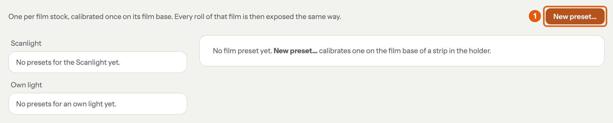
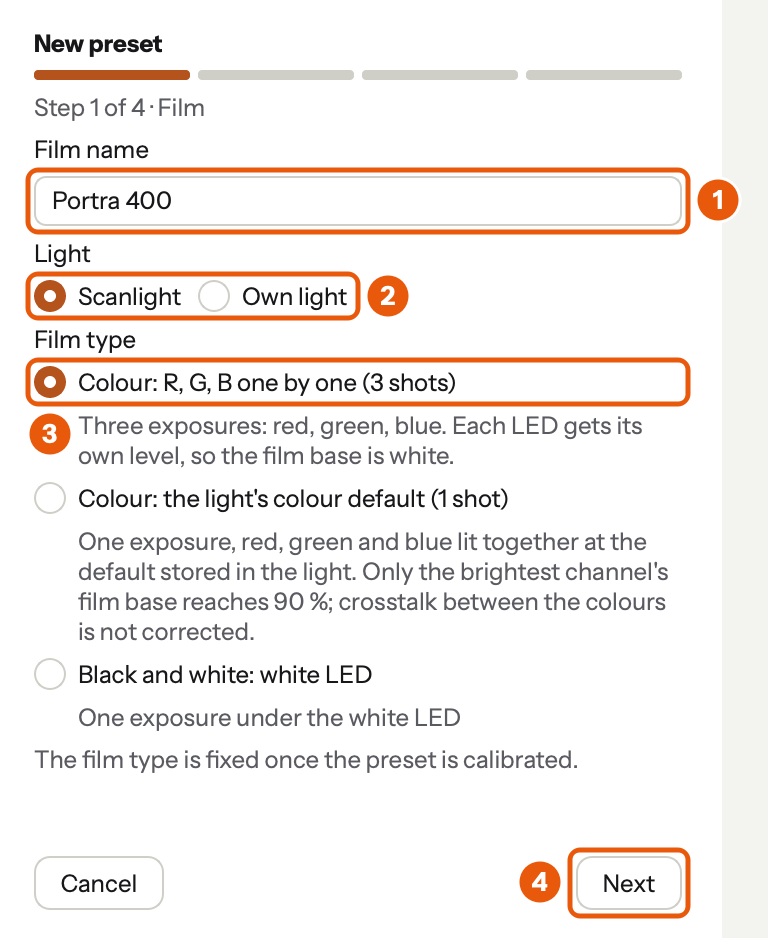
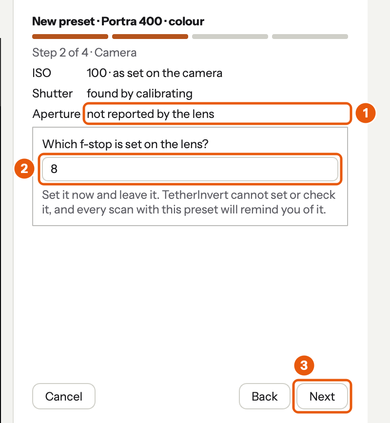
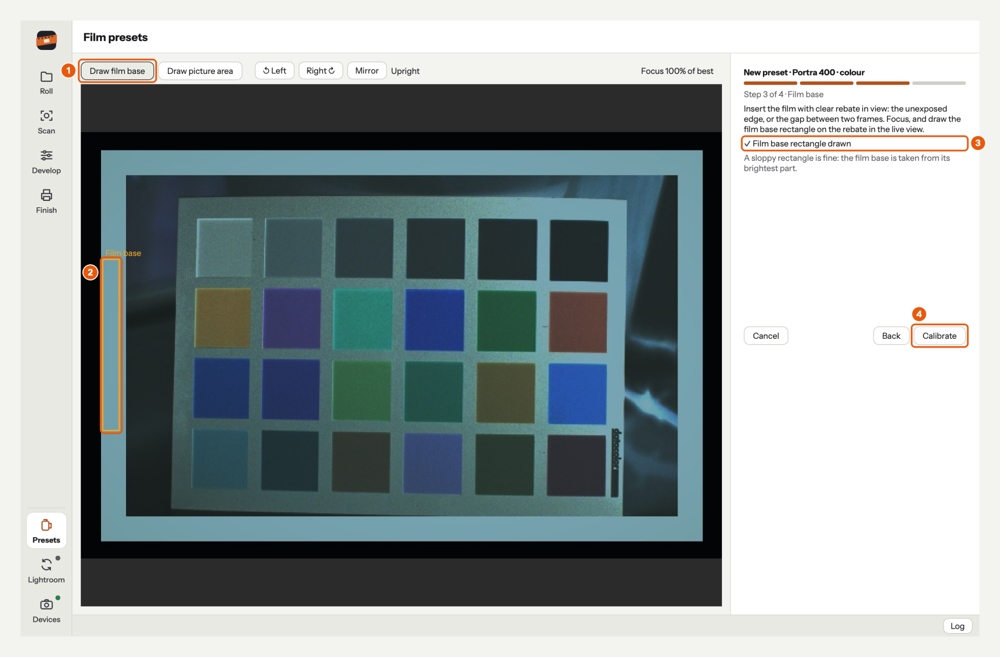
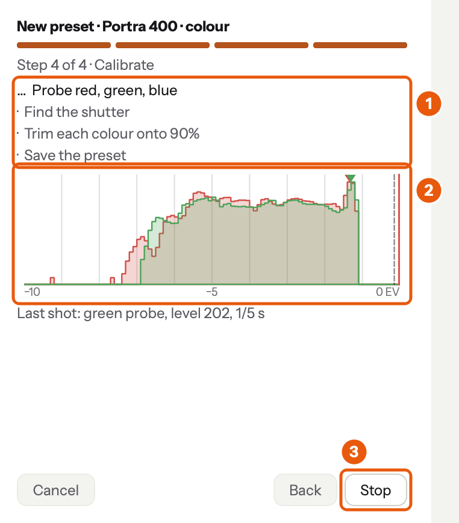
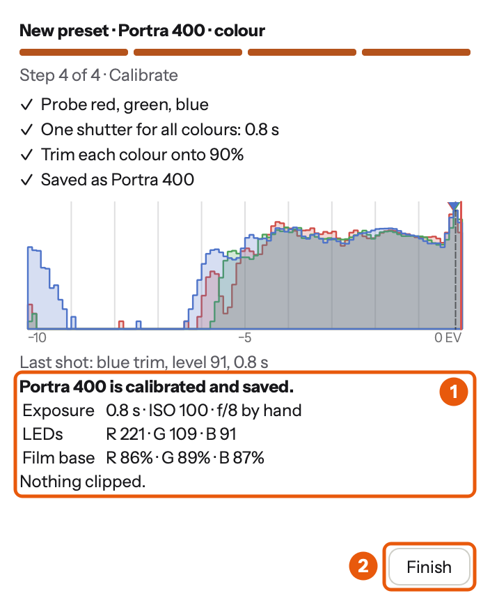
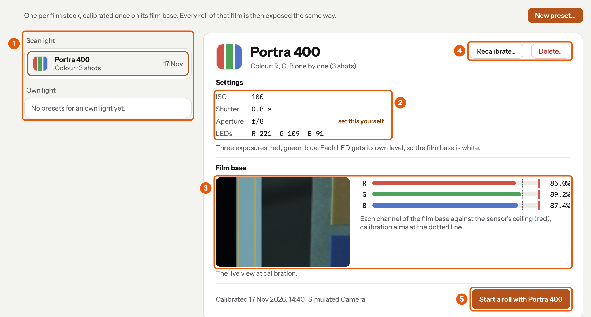

# Calibrating a film stock

Do this once per film stock, and again when you change ISO, f-stop or light. It takes about a minute.

**You need:** a developed strip of the stock in the holder, with clear film base in view: the rebate
between two frames, or the leader. Camera and light connected (see [Your rig](rig.md)).

## 1. Frame and focus

Put the strip in the holder and look at the live view on **Scan**. Focus on the grain. The focus readout above the
live view (*Focus … of best*) is the sharpness as a share of the best seen so far: turn through best
focus and back until it reads 100 %.

## 2. Open the wizard

Open **Presets** in the rail and click **New preset…** (**1**) at the top right. The Roll page's preset
picker has it too.

The calibration wizard opens in the column beside the live view, where you draw the film base. The
roll stays as it is until the wizard is done; **Cancel** or **Finish** bring back the list of presets.

## 3. Name the film and choose how it is lit

1. Type the film's name, as you want to see it in the preset list: *Portra 400*.
2. Choose the light: **Scanlight**, or **Own light** for any other light (see [Lights](lights.md)).
3. Choose the film type. For colour negative with a Scanlight: **Colour: R, G, B one by one (3 shots)**.
   For black and white: **Black and white: white LED**.
4. Click **Next**.

A name that exists already (in any upper or lower case) is replaced; the wizard says so before anything
happens.

## 4. Tell it what the camera cannot

1. The camera reports what it can: here ISO and shutter, but not the aperture of a lens without
   electronic contacts.
2. Type the f-stop that is set on the lens (*8* for f/8). **Set it now and leave it**: every session
   with this preset reminds you of it. The field is filled in from the preset you calibrated last.
3. Click **Next**.

## 5. Draw the film base rectangle

1. **Draw film base** is chosen.
2. Drag a rectangle over clear film in the live view: the rebate between two frames, or the leader. It
   may overlap the picture or the holder a little, but must not touch a sprocket hole: that is bare
   light, not film.
3. The wizard confirms *Film base rectangle drawn*.
4. Click **Calibrate**.

## 6. Let it calibrate

1. The stages tick off: a probe shot per colour, one shutter for all colours, each colour trimmed onto
   90 %, the preset saved.
2. The histogram shows every shot, in stops below the sensor's ceiling. The marker at the right is
   where the film base landed: watch each colour walk onto the target.
3. **Stop** ends it without saving anything.

## 7. Check the result and finish

1. The result: the exposure (with what you set by hand), the LED levels, and where the film base landed
   in each channel. *Nothing clipped* is what you want to read.
2. Click **Finish**.

If calibration fails, the wizard says why and what to do (for example *Too dark even at the longest
exposure: open the aperture*), and **Back** takes you to the rectangle.

## 8. The preset is ready

1. The new preset is chosen in the list. Presets are grouped by light; the mark beside each says how it
   scans: three stripes for red, green and blue one by one, the three blended for colour in one shot,
   black to white for black and white, a dashed outline for your own light.
2. Its settings. What you have to set yourself is marked *set this yourself*.
3. The film base: the live view around the rectangle when you calibrated, and how close each channel
   came to the sensor's ceiling (the red line); calibration aims at the dotted line.
4. **Recalibrate…** runs the wizard again from the camera step, with the same name, film type and
   rectangle. **Delete…** removes the preset, after asking.
5. **Start a roll with Portra 400** opens Roll with the preset chosen.

Rolls already scanned keep their own copy of a preset, so recalibrating or deleting it never changes
them. During a session the list stays on the session's preset.

**Next:** [start a session](session.md).
