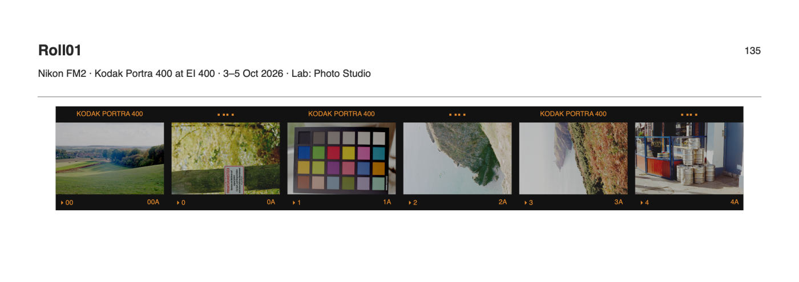

# Contact sheet

A contact sheet of the roll, like a darkroom contact print: every frame as its print will be, on film
strips with edge print, the roll's metadata in the header. As an A4 PDF and as PNG at 300 dpi, in the
roll's folder, ready for the archive.

## 1. Make it

On **Finish**, under *Contact sheet*, click **Write contact sheet** (**2** in
[the picture of Finish](finishing.md)). It is written in a moment and opens in your PDF viewer. Beside
the panels, Finish shows every page as it will be written, and follows your changes.

The options beside the button (**3**) are kept for the roll:

- **Film rebate**: on, the frames on black film strips; off, on white paper with the number under each.
- **Sprocket holes**: for 135, drawn on the rebate; off by default. Only with the rebate.

## 2. The sheet

- **Header**: the roll's name, and camera · film at EI · dates · developer from its [metadata](metadata.md).
  The roll's notes are at the foot of the last page.
- **Layout** from the roll's *Format*: 135 six to a strip and 42 to a page; 120 6×4.5 16 a page, 6×6
  12, 6×7 10, 6×9 8. A longer roll goes onto more pages.
- **Edge print**: the film stock along the top, the frame numbers along the bottom (135: `▸ 7 … 7A`).
  Orange on colour negative film, white on black and white.
- Every frame as developed, from the previews: no prints or RAW files are needed. A portrait frame lies
  on its side, like on a strip.

The files: `Roll01_contact.pdf` and `Roll01_contact.png` in the roll's folder (a longer roll:
`Roll01_contact_2.png`, …). Lightroom doesn't see them.

On the command line: `tetherinvert contactsheet ~/Scans/Roll01 --sprockets`.
