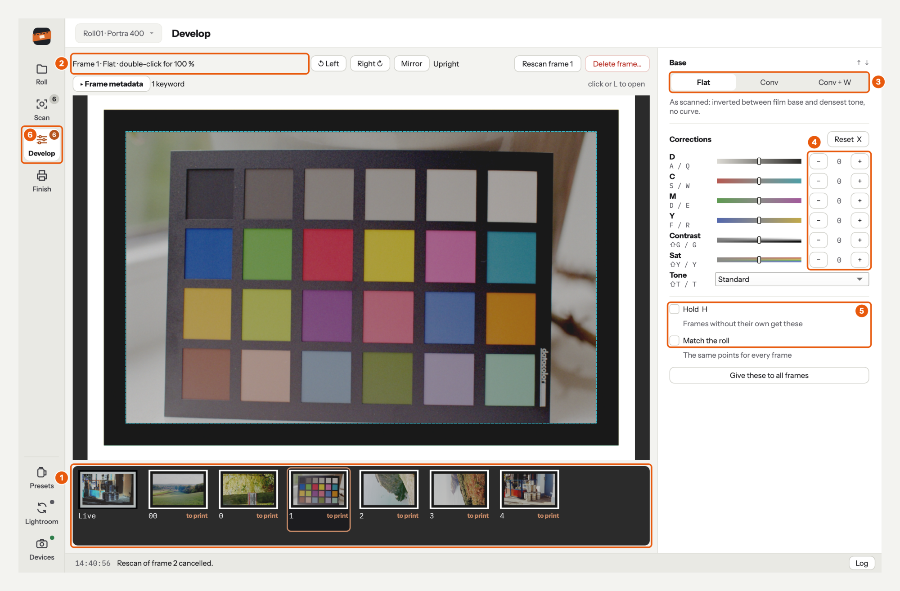
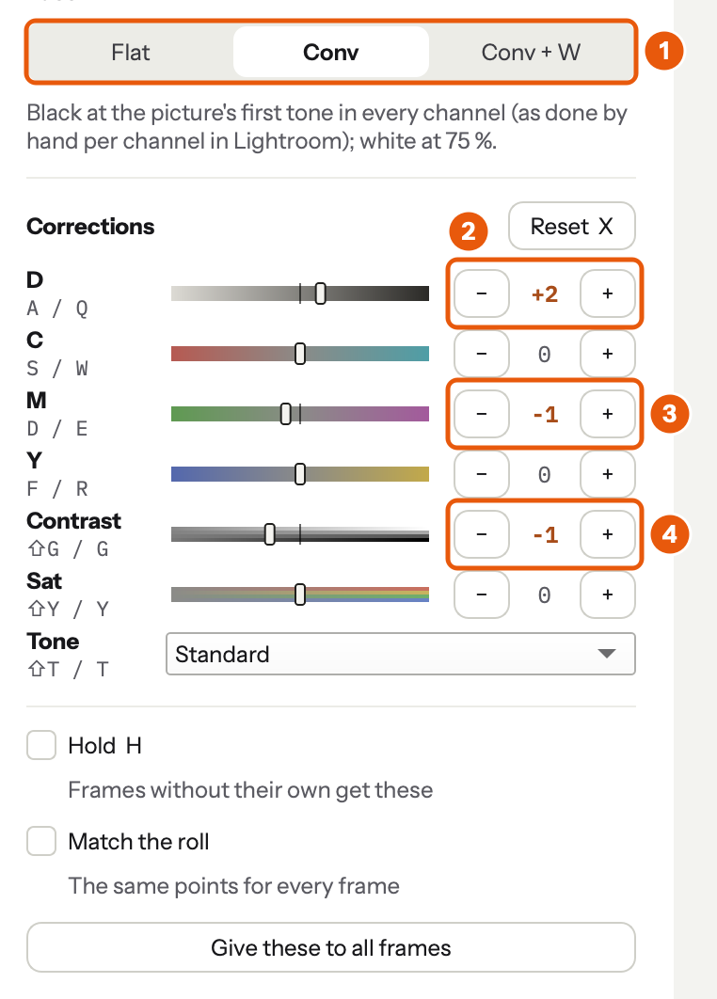

# Developing

Every frame is scanned flat: the master, with nothing clipped and no curve
([why](concepts.md#4-scan-flat-the-master)). On **Develop** you develop each frame from it: a starting
point and a few corrections, seen on screen at once. On **Finish** you then print the whole roll in one
go into `prints/` ([Finishing the roll](finishing.md)).
The flat scans stay as they are. The camera and the RAW files are not needed for any of this.

Best done once the roll is scanned. It works the same during a session, on any frame you open.

## 1. Open the first frame

Click frame 1 in the strip, or **Develop** in the rail (it opens the frame you looked at last).

1. The strip. **← / →** go to the previous and next frame.
2. What is shown: the frame, its base, and that a double-click shows it at 100 %.
3. **The base**: what the frame is developed from (below). **↑ / ↓** step through them.
4. **The corrections**: − and + for each, the value between them. Left of them each correction's keys
   and a gauge showing which way it moves the picture.
5. **Hold** and **Match the roll** (below).
6. The rail's **Develop** counts the frames due for a print.

The frame is always shown as its print will be.

## 2. Choose the base

- **Flat:** the scan as it is (the default). Milky: black at 10 %, white at 75 %.
- **Conv** (Converted): black set at the picture's own darkest tone, in every channel: the step you
  would otherwise do by hand with Lightroom's tone curve, channel by channel. White stays at 75 %.
- **Conv + W** (Converted + white): the same, and the brightest tone taken up to 98 %.

Compare them with **↑ / ↓**: the corrections stay the same, only the starting point changes.

## 3. Correct

Press the keys (or click − and +). The picture follows at once.

Here the frame is on **Conv** (**1**), two steps denser (**2**, D +2), one step less magenta (**3**,
M −1) and a little softer (**4**, contrast −1).

| Key | Does |
|---|---|
| **Q** / **A** | D: density, + darker |
| **W** / **S** | C: + more cyan, − more red |
| **E** / **D** | M: + more magenta, − more green |
| **R** / **F** | Y: + more yellow, − more blue |
| **G** / **Shift+G** | contrast harder / softer |
| the key right of **T** / with **Shift** | saturation more / less: **Y** on a US keyboard, **Z** on a German one |
| **T** / **Shift+T** | tone: Standard, All Hard/Soft, Highlight Hard/Soft, Shadow Hard/Soft |
| **H** | Hold: frames without corrections of their own get these, new scans too |
| **X** | take the frame's corrections back |
| **C** (hold) | compare: the frame without its corrections |
| **↑ / ↓** | the base |
| **← / →** | previous, next frame |

The controls are modelled on the Fujifilm Frontier SP-3000's, with finer steps: one D step is about
1/16 stop. There is no curve of TetherInvert's own, and no sharpening. **Give these to all frames** gives
this frame's corrections to every frame. **Reset X** takes them back. Everything is saved in the roll as you go.

On a black-and-white frame C, M, Y and saturation are greyed out.

## 4. The next frame

Press **→** and repeat. With **Hold** on (**H**), a frame that has no corrections of its own starts
with the held ones, so a run of similar frames needs only the odd touch.

## 5. Print the roll

When the frames are developed, open **Finish** and print them: see
[Finishing the roll](finishing.md#prints).

## Match the roll

**Match the roll** develops every frame with the same black and white points (the median over the
roll), so colour and density agree from frame to frame. Off, each frame uses its own. Turn it on for a
roll shot in the same light, or when frames have nothing black in them (fog, snow, a wall): a frame's
own black point is only right when the frame holds something black. Changing it makes every print due.

## What is in the files

**The flat scan** (`scans/`). Per channel, the frame is stretched in log density between the film base
(from the preset) and the densest tone in the picture, then inverted: film base at 10 %, the densest
tone at 75 %, no contrast curve. Tagged gamma 2.2.

**The print** (`prints/`). The flat scan developed with the frame's base and corrections, at full
size, the same way as the picture on screen.

**The linear negative** (`negative/`, if chosen). The merged exposures as the sensor recorded them: no
white balance, no inversion. Tagged gamma 1.0.

All are 16-bit TIFFs, losslessly compressed, with an ICC profile (sRGB primaries; ProPhoto, for
stronger colour, from the command line: `tetherinvert render <roll> --primaries prophoto`), and the
roll's [metadata](metadata.md). The primaries are a convention, not a measurement of the light and
sensor.
