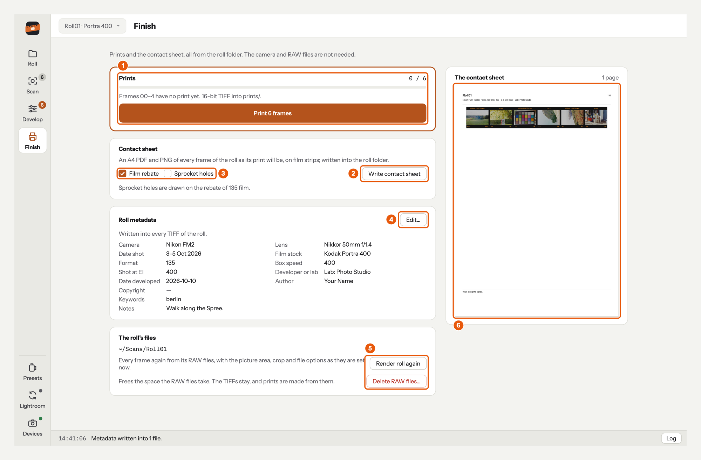
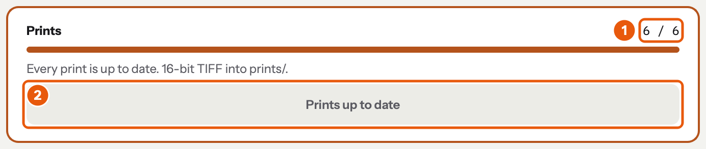

# Finishing the roll

Once the frames are developed, **Finish** turns the roll into what you keep: the prints, the contact
sheet, the metadata in every file. Everything here is made from the roll's folder: the camera and the
RAW files are not needed.

1. **Prints**: how many are up to date, which are not, and the button that prints them.
2. **Write contact sheet**.
3. Its options, **Film rebate** and **Sprocket holes**.
4. **Edit…** the roll's metadata, shown here as it is in the files.
5. **The roll's files**: its folder, **Render roll again** and **Delete RAW files…**.
6. The contact sheet as it will be written, every page.

For a roll not started yet, Finish keeps its panels with every button off, and says why.

## Prints

Under *Prints*: how many prints are up to date out of all frames (*0 / 6*), and which frames changed
since they were printed, which have no print yet and which are still being rendered.

Click **Print 6 frames**: every frame without an up-to-date print is printed into `prints/`, as a
16-bit TIFF.

1. The count: *6 / 6*. In the strip, *to print* is gone from the frames, and the rail's **Develop** has
   no count.
2. The button reads **Prints up to date**.

A print is due again when you change its base or corrections, rescan the frame, render it again or
turn it. A print that fails does not stop the others; the log says which failed. What a print is:
[Developing](developing.md#what-is-in-the-files).

## Contact sheet

**Write contact sheet** writes the roll's contact sheet as PDF and PNG into the roll's folder, and
opens it. **Film rebate** and **Sprocket holes** are kept for the roll; sprocket holes are drawn only
with the rebate, on 135 film. Beside the panels, every page as it will be written, updated as you
change the frames, the options or the metadata. See [Contact sheet](contact-sheet.md).

## The roll's metadata

The roll's fields as they are written into its files; empty ones show *—*. **Edit…** opens the Roll
page at its metadata, with the cursor in *Camera*. **Save metadata** there writes the changes into
every file of the roll. See [Metadata](metadata.md), and for photos already in Lightroom,
[After you change metadata in TetherInvert](lightroom.md#after-you-change-metadata-in-tetherinvert).

## The roll's files

- The roll's folder, where everything is.
- **Render roll again** writes every frame again from its RAW files, with the picture area, crop,
  flat field and file options as they are now: after drawing a better picture area, for example.
  Bases and corrections are kept.
- **Delete RAW files…** removes the kept exposures of every frame that has its scan, after asking.
  Developing, printing and the contact sheet go on without them; only *Render roll again* needs them.

**Next:** work on in [Lightroom Classic](lightroom.md), or any editor.
