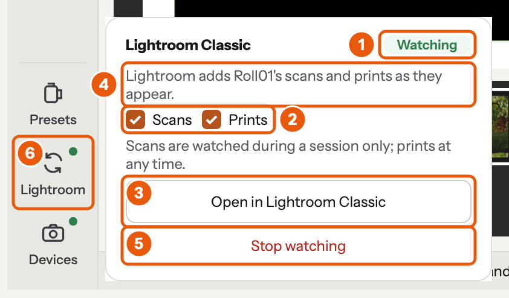

# Lightroom Classic

TetherInvert works with Lightroom Classic through a small plug-in, which does two things:

- **A hot folder**: Lightroom adds the roll's files to its catalog as they are written, the flat scans
  while you scan, the prints when you print. Nothing is moved, copied or renamed.
- **The TetherInvert fields**: film stock, EI, developer, the scanning rig and more, in Lightroom's
  Metadata panel.

You can use the plug-in's fields without the hot folder, on files you import yourself (see
[Metadata in Lightroom](#metadata-in-lightroom)). macOS only.

## 1. Open the roll in Lightroom

Click **Lightroom** at the foot of the rail.

1. The chip says what Lightroom is doing with the roll: *Watching*, *Watching Roll02* (another roll),
   *Not watching*, *Asking…* (TetherInvert waits for its answer) or *No answer*.
2. Tick what it should watch: **Scans** (`scans/`, only during a session) and **Prints** (`prints/`,
   any time). Both are ticked at first.
3. Click **Open in Lightroom Classic**. Lightroom starts if it isn't running.
4. The line says what Lightroom watches, and what the button would ask for when that is something else.
5. **Stop watching** ends the watch, without starting Lightroom.
6. The rail's Lightroom dot is green while Lightroom watches.

**The first time**, TetherInvert asks to install its plug-in. Say yes, and if Lightroom was already
open, restart it once. This is also how you get the plug-in if you only want its fields: click the
button once. Lightroom's own Auto Import can't stand in for the hot folder: its watched folder must be
empty, and it moves the files away.

## 2. In Lightroom

Every TIFF that appears is added where it is, under the roll's folder: *Roll01 › scans* and
*Roll01 › prints*. Turn on *Library › Show Photos in Subfolders* to see both together.

- Files already there are added too.
- A frame rescanned or rendered again keeps its place in the catalog, with your edits; Lightroom shows
  the new picture.
- The watch lasts until you ask for other folders, until **Stop watching** (or *Library › Plug-in
  Extras › TetherInvert: stop watching* in Lightroom), or until Lightroom quits. A request from the
  same day is picked up again when Lightroom starts.

If the chip says *No answer* (TetherInvert waits two minutes), open *File › Plug-in Manager* in
Lightroom: **TetherInvert hot folder** should be there and enabled.

## Metadata in Lightroom

What TetherInvert writes into its files is described in [Metadata](metadata.md). In Lightroom, it
splits into two kinds of field, and they are read differently:

| | Standard fields | TetherInvert fields |
|---|---|---|
| What | camera, lens, capture time, ISO, exposure, creator, copyright, caption, keywords | *TetherInvert Film* (film stock, format, box speed, EI, developer, dates) and *TetherInvert Scan* (roll, frame, scanning rig, flat field, a print's base and corrections) |
| Where | Lightroom's usual Metadata panel | choose **TetherInvert** at the top of the Metadata panel |
| Read by | Lightroom itself | the plug-in only: Lightroom never fills a plug-in's fields by itself |

The film fields can filter the Library (*Library Filter › Metadata*). The TetherInvert fields are read
only in Lightroom: change them in TetherInvert.

### Photos the hot folder added

Everything is filled as each file is added. While the folder is watched, a change in TetherInvert is
followed within seconds: the TetherInvert fields, caption, creator, copyright and keywords.

### Photos you imported yourself

After *Import*, *Synchronize Folder* or dragging files in, Lightroom has read the standard fields,
but the TetherInvert fields are empty. To fill them:

1. Click the roll's folder in the Folders panel. With *Library › Show Photos in Subfolders* on, its
   scans and prints are shown together.
2. Choose *Library › Plug-in Extras › TetherInvert: read metadata*.

The command reads every photo shown, or the photos you selected when you selected more than one.

The dialog counts the photos updated, those already up to date, and those skipped because their file
has no TetherInvert metadata (a file TetherInvert did not write).

Clicking **Open in Lightroom Classic** in TetherInvert does the same for the photos in the folders it
starts watching: when it goes through files already in the catalog, it brings their fields up to date.

### After you change metadata in TetherInvert

TetherInvert writes the change into the files at once (see
[When the files are written](metadata.md#when-the-files-are-written)). What Lightroom does with it:

| Fields | In a watched folder | Otherwise |
|---|---|---|
| TetherInvert fields, caption, creator, copyright, keywords | updated by themselves | *TetherInvert: read metadata* |
| Camera, lens, capture time, ISO, exposure | *Metadata › Read Metadata from Files* | *Metadata › Read Metadata from Files* |

Lightroom reads camera, lens, capture time, ISO and exposure only when a file is added; the SDK does
not let the plug-in set them. So after typing a frame's aperture and shutter, for example, use *Read
Metadata from Files* once. It replaces the catalog's metadata of those photos with the file's,
including what you typed in Lightroom.

What the plug-in keeps apart from your own work in Lightroom:

- Keywords you add in Lightroom are never touched. The plug-in removes only keywords it added itself
  that TetherInvert no longer has.
- Caption, creator and copyright are taken from TetherInvert whenever it has a value for them, and
  left alone when it has none. Type them in TetherInvert, or leave them empty there.

## The plug-in

- After an update of TetherInvert, **Open in Lightroom Classic** updates the plug-in too, and the log
  says so. Restart Lightroom once afterwards.
- TetherInvert and the plug-in talk through three small files in `~/.tetherinvert/lightroom`;
  `plugin.log` says what was added, refreshed and read, and what was not.
- *Library › Plug-in Extras › TetherInvert: status* says what the plug-in is watching.
