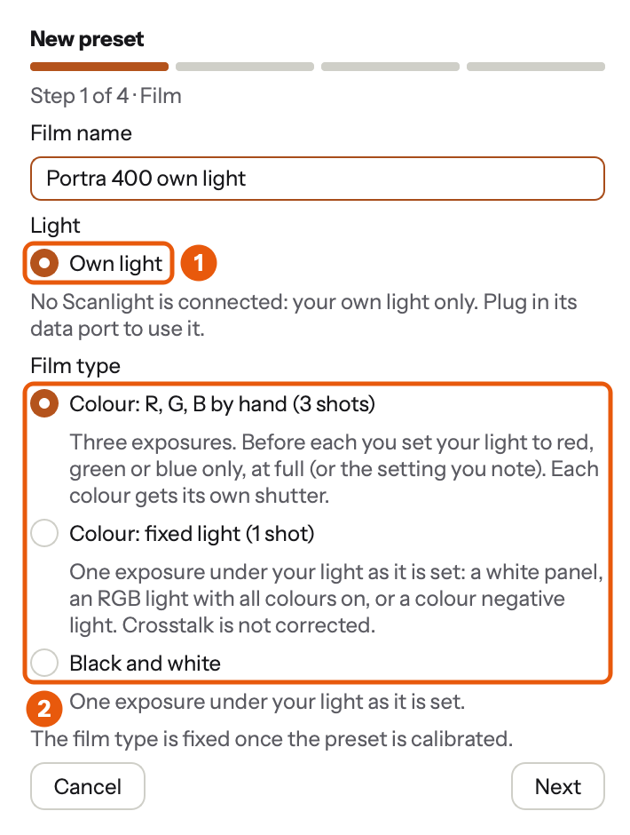
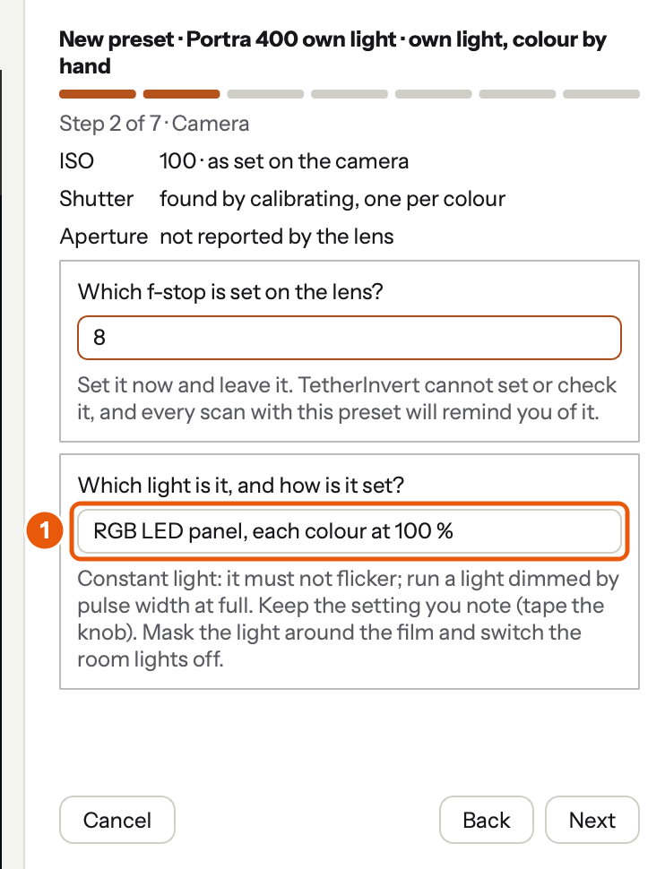
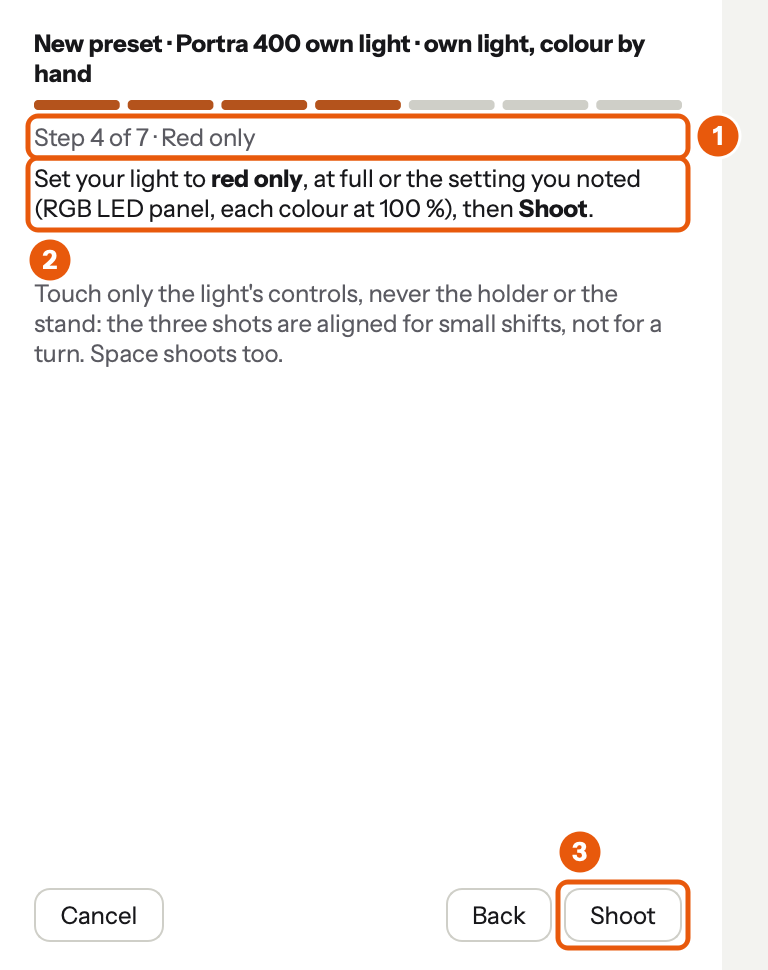
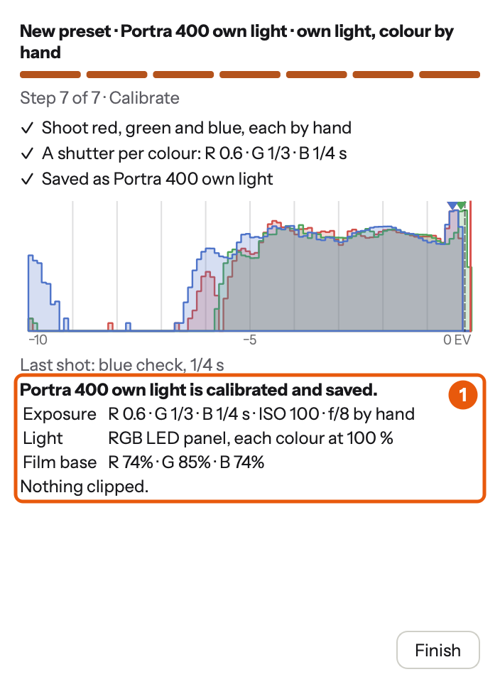
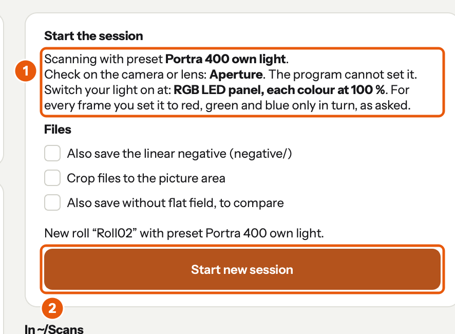
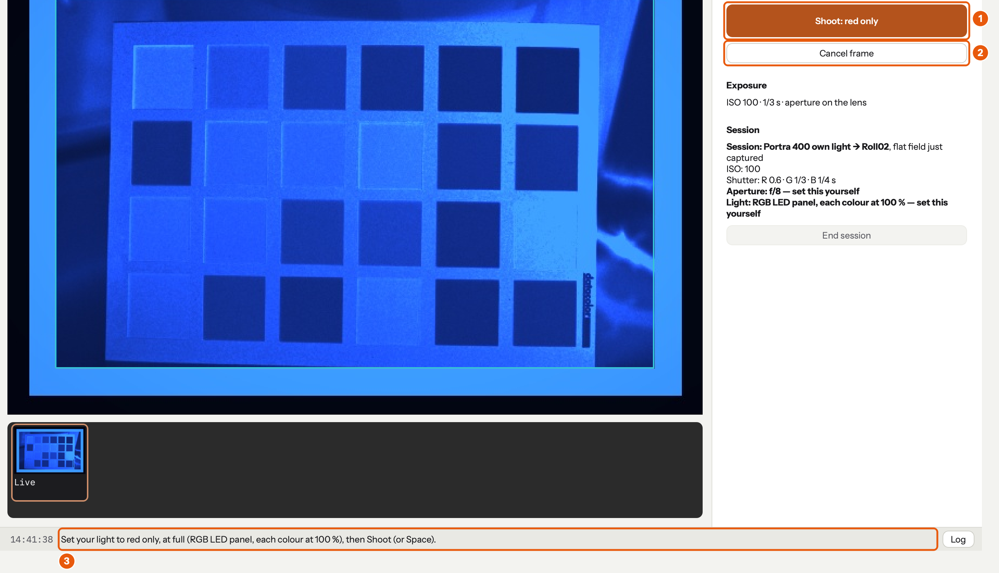

# Lights

TetherInvert is built around single-channel RGB scanning: each frame shot under red, green and blue
light one after the other, so each of the film's dye layers is read on its own. How much of that
it can do for you depends on the light.

## With a Scanlight

TetherInvert drives the [Scanlight](https://github.com/jackw01/scanlight) over USB: it switches the
colours, sets their levels and calibrates them. Connect the **data** USB-C port; the other one is
power only. Use a power supply of at least 2 A.

Each film preset says how the film is lit:

| Mode | Exposures per frame | Calibration finds | Film base |
|---|---|---|---|
| **Colour: R, G, B one by one** (3 shots) | red, green, blue, merged into one frame | a level per LED, one shutter | 90 % in every channel: white balanced |
| **Colour: the light's colour default** (1 shot) | one, all three LEDs lit together | the shutter only; the levels are read from the light | 90 % in the brightest channel, the others lower |
| **Black and white: white LED** | one | the white level, one shutter | 90 % in the brightest channel |

**R, G, B one by one** is what TetherInvert is made for: the cleanest colour separation, and the white
balance comes from calibration.

**The colour default** is the colour stored in the Scanlight, set in its web app (line up the
channels' histogram peaks on clear developed film, camera at 5000 K). Calibration reads it and
keeps it in the preset, so changing it later in the web app does not change a roll scanned with
that preset; calibrate again to take the new default. TetherInvert never writes the default. A light
whose default was never set reads R 255 G 255 B 255, and the calibration result says so.
One shot is three times quicker and needs no aligning of the three exposures, but the colours
cross over between the LEDs and the camera sensor's channels (reds too pink, greens too yellow),
and that is not corrected yet. With all three LEDs on, a weak power supply dims the light; that
shows only as a slower shutter.

## Without a Scanlight

Any other light works too, set by hand: a white panel (95+ CRI), an RGB light with a knob per
colour, a light made for colour negative (such as the CineStill CS-LITE+ SpectraCOLOR), or a
Scanlight run from its own buttons. TetherInvert then controls only the camera. In the calibration
wizard choose *Own light* in the first step (it is the only choice while no Scanlight is
connected), then a mode.

1. **Own light** is chosen (the only choice while no Scanlight is connected).
2. The three modes for your own light (below).

In the next step the wizard asks for the light itself, like the f-stop:

1. Which light it is and how it is set: *RGB LED panel, each colour at 100 %*. This note is stored with the
   preset, shown in every session, and written into the files.

The modes:

| Mode | Exposures per frame | Calibration finds |
|---|---|---|
| **Colour: R, G, B by hand** (3 shots) | red, green, blue; before each one you set the light to that colour alone, prompted | a shutter per colour, with the light at full |
| **Colour: fixed light** (1 shot) | one, the light as it is | the shutter only |
| **Black and white** | one, the light as it is | the shutter only |

### Which mode for which light

- **RGB with a knob per colour:** colour by hand. As a fixed light with all colours on it works
  too; its crosstalk is then not corrected.
- **White, 95+ CRI:** fixed light. Colour negative under white light separates the colours less
  than under narrowband light; blue lands lowest under the orange mask.
- **Narrowband, fixed (CS-LITE+ SpectraCOLOR):** fixed light with the colour negative sheet in,
  black and white without it. Name the sheet in the light's note: the calibration holds only with
  it.
- **A Scanlight as your own light:** with only its power port, its right button switches between
  RGB and white at its stored levels: a fixed light, or black and white. With its data port, start
  TetherInvert with `--no-light` (it then never opens the port) and run `tetherinvert light` in a second
  terminal: it holds the port and reads `r`, `g`, `b`, `w` (each with an optional level, 255 if
  none), `rgb R G B`, `off` and `q`, so colour by hand works too.

### Colour by hand, step by step

For every shot (calibration, flat field, scan) TetherInvert asks for one colour alone. In the wizard,
after the film base:

1. Red, then green, then blue: one step each.
2. Set your light to that colour alone, at full or at the setting you noted.
3. **Shoot**, or Space. A shot that does not look like that colour alone is refused, says why, and
   is asked for again.

1. The result: a shutter per colour, with the light as you noted it.

On the Roll page, *Start the session* reminds you of the light:

1. Which light, how it is set, and that every frame is shot in red, green and blue in turn.
2. **Start new session**. On Scan, **Capture flat field** then asks for red, green and blue in turn,
   as a scan does (below); *Cancel flat field* stops it and goes back to the flat field's step.

Each frame is then three prompted shots:

1. **Shoot: red only**: the button names the colour it wants; Space shoots too. Then green, then blue.
2. **Cancel frame** drops the frame. A frame is kept only once all three are right.
3. What to set, with the light's note, in the status bar.

Touch only the light's controls between the shots, never the holder or the stand: the three shots
are aligned for small shifts, not for a turn.

### Working with your own light

- **The light is a setting by hand,** like the f-stop: the wizard asks which light it is and how
  it is set ("RGB LED panel, each colour at 100 %"). It is stored with the preset, shown in every reminder
  ("Switch your light on at: …") and written into the files as the light used.
- **Constant light.** It must not flicker. Run a light dimmed by pulse width at full brightness:
  TetherInvert never scans faster than 1/250 s.
- **Fixed setting.** Keep the setting you noted; the calibration holds only at it. Tape the knob.
- **No stray light.** Mask the light around the film and switch the room lights off.
- **Flat field:** the bare light with light, aperture and ISO unchanged; only the shutter moves,
  down to 1/1000 s. A light that flickers shows bands at such speeds, and the flat field is
  refused, saying so. If the calibration result says your light is bright (a shutter of 1/250 s or
  faster), close the aperture a stop or dim the light and calibrate again.
- **In a session** there are no LEDs to lower: where the flat field shows the frame brighter than
  calibration left room for, the shutter is shortened by thirds of a stop, each colour's on its
  own. The session text says so.
