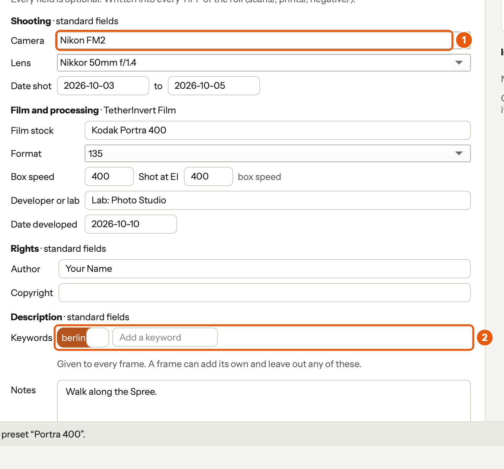
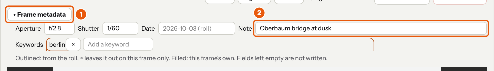

# Metadata

TetherInvert keeps two kinds of metadata for every frame:

- **What you shot**: the camera, film and dates. TetherInvert cannot know these, so you type them
  in once per roll, and per frame if you like. Every field is optional; an empty one is not written.
- **How it was scanned**: the scanning camera, light, preset and flat field. TetherInvert records
  these by itself.

Both go into every TIFF of the roll (`scans/`, `prints/`, `negative/`) as XMP, so they travel with the
file to any editor. Camera, film and dates also appear on the [contact sheet](contact-sheet.md).
For how the fields appear in Lightroom, see [Lightroom Classic](lightroom.md#metadata-in-lightroom).

## The roll

The roll's metadata is on the **Roll** page, filled in before a new session starts (see
[Starting a session](session.md)) and changed there at any time. **Finish** shows it as it is in the
files; **Edit…** there opens this form.



1. **Camera** and **Lens** offer what you typed before.
2. **Keywords**: Enter or a comma adds one.

| Group | Fields |
|---|---|
| Shooting | camera, lens, date shot (from, to). Camera and lens offer what you typed before. |
| Film and processing | film stock, format (135, 120 6×4.5, 6×6, 6×7, 6×9: the contact sheet's layout), box speed, the EI you shot at (the push or pull is shown beside it), developer or lab, date developed |
| Rights | author, copyright |
| Description | keywords (Enter or a comma adds one), notes |
| Scanning | read only, recorded by TetherInvert (below) |

*Copy from roll…* takes another roll's fields.

## A frame

Open a frame on Develop, then click **Frame metadata** above it, or press **L**.



1. **Frame metadata** opens and closes the row. It stays as you leave it.
2. The fields: aperture and shutter as you shot it, the date (empty means the roll's first day), a
   note, keywords.

The roll's keywords are shown outlined: **×** leaves one out on this frame only. The frame's own are
filled. A field that is not taken (*1/60* typed as the aperture) is marked red, keeps what it had, and
the [log](window.md#the-log) says why.

These fields start empty: they are never taken from the camera on the copy stand.

## What TetherInvert records by itself

The roll's name, the frame number and the kind of file (flat positive, linear negative, print); the
scanning camera, light, preset and exposure; whether the flat field was applied and when it was
captured; the scan time and TetherInvert's version; for a print, its base and corrections.

These are kept apart from the shooting fields, so an editor shows the camera you shot the film with,
not the one on the copy stand.

## When the files are written

The metadata in the files always follows TetherInvert:

- **A new roll**: its fields are written when its session starts, into every file from then on.
- **Save metadata** (roll): written into every file of the roll at once.
- **The frame row**: saved a moment after you stop typing, and written into that frame's files.
- **A rescan, a render, a print**: the new file gets the metadata as it is at that moment.

Only the metadata is replaced; the pixels are not touched. An editor that has already read a file
does not always notice the change: see [Lightroom Classic](lightroom.md#after-you-change-metadata-in-tetherinvert).

## Where it goes in the file

| Field | Written as | Shown in editors as |
|---|---|---|
| Camera | `tiff:Model` | Camera |
| Lens | `aux:Lens`, `exifEX:LensModel` | Lens |
| Date shot (the frame's, else the roll's first day) | `exif:DateTimeOriginal`, `photoshop:DateCreated` | Capture Time |
| EI, else box speed | `exif:ISOSpeedRatings` | ISO |
| Aperture, shutter (frame) | `exif:FNumber`, `exif:ExposureTime` | Exposure |
| Author, copyright | `dc:creator`, `dc:rights` | Creator, Copyright |
| Note (frame), then notes (roll) | `dc:description` | Caption |
| Keywords: the roll's but those left out, then the frame's | `dc:subject` | Keywords |
| Film stock, format, box speed, EI, developer, date developed, last day shot | *TetherInvert Film* (`XMP-tetherinvertFilm` in exiftool) | Lightroom, through the plug-in |
| Roll, frame, file, scanning camera, light, preset, exposure, flat field, scan time, software; for a print its base and corrections | *TetherInvert Scan* (`XMP-tetherinvertScan`) | Lightroom, through the plug-in |

The standard fields (the first eight rows) are read by any editor that reads XMP. *TetherInvert Film*
and *TetherInvert Scan* are TetherInvert's own: other programs keep them but don't show them, and
Lightroom shows them through TetherInvert's plug-in. To see everything a file holds:

```
exiftool -XMP:all ~/Scans/Roll01/scans/Roll01_001.tif
```

## On the command line

`tetherinvert metadata ~/Scans/Roll01 film="HP5 Plus" ei=800` sets the roll's fields and writes them into
its files; `--frame 7 note="Anna"` sets a frame's. See [Command line](command-line.md).
