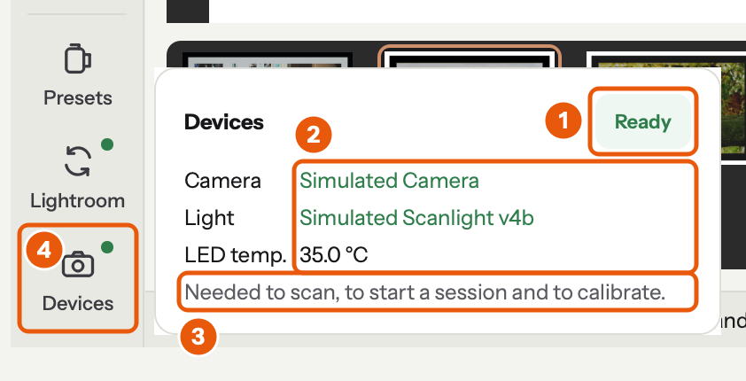

# Your rig

## The camera

| Setting | Value |
| --- | --- |
| USB mode | PC Remote (not Mass Storage or MTP) |
| Exposure mode | M |
| Image quality | RAW only (RAW+JPEG hands over the JPEG) |
| Save destination | Computer only, if you do not want a copy on the card. TetherInvert asks the camera for this; some bodies take it only from their own menu. Sony A6700: MENU → Network → Cnct./PC Remote → Remote Shoot Setting → Still Img. Save Dest. → Destination Only. `tetherinvert status` says what the camera does. |
| ISO, aperture | Set them yourself; calibration leaves them alone. Auto ISO is switched to the lowest fixed ISO. A lens without electronic contacts: the f-stop is asked for at calibration and you are reminded of it in every session. |

TetherInvert controls the camera through [libgphoto2](http://www.gphoto.org/proj/libgphoto2/support.php),
which supports many bodies from Sony, Canon, Nikon, Fujifilm and others.

On macOS the system camera service grabs a free camera and can hold it for minutes. The window keeps
the camera for as long as it is open, so prefer it to one-off commands. If the camera reads as in
use, unplug and replug the cable and quit Photos, Image Capture and sync clients.

## The light

- **Scanlight:** the data USB-C port (the other is power only), a power supply of at least 2 A.
  The window finds it within a few seconds, and shows its LED temperature under **Devices**.
- **Your own light:** see [Lights](lights.md#working-with-your-own-light): constant, fixed
  setting, no stray light.

Camera and light are connected separately: the window says which one is missing, and a cable that
comes loose costs only that device.

## The window

**Devices** at the foot of the rail shows what is connected.

1. The chip: *Ready*, *Camera missing*, *Light missing*, *Camera and light missing*, or *Not needed
   here* on Develop, Finish and the list of presets.
2. The camera, the light and the light's LED temperature: green when connected, red *not connected*.
   With your own light the light reads *none: own light*.
3. What needs them: scanning, starting a session and calibrating.
4. The rail's dot: green or red where the devices are needed, grey where they are not.

## Checking it

**Help › Run Doctor…** shows what is installed and connected, takes one test shot without changing
any camera setting, and says whether the file decodes. Without the window, `tetherinvert doctor`
prints the same; close the window first then, as only one program can hold the camera.
