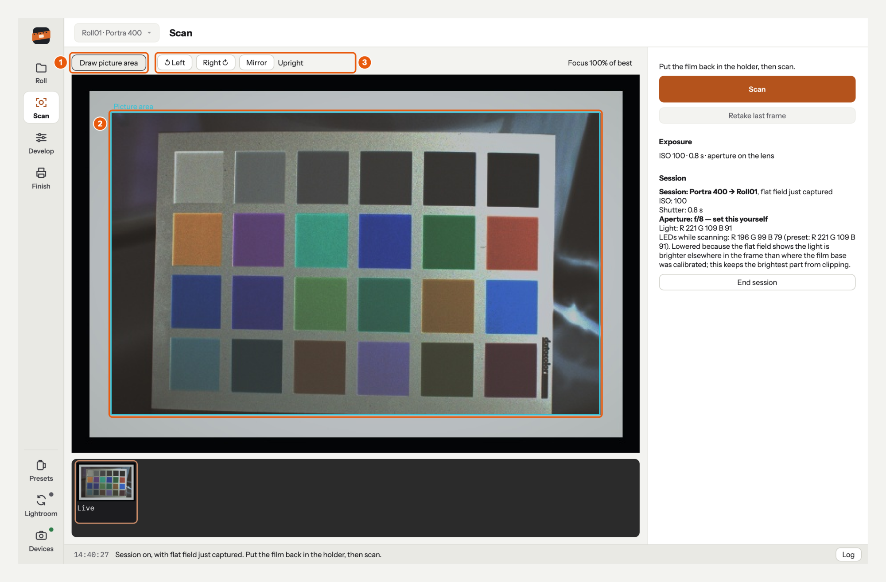
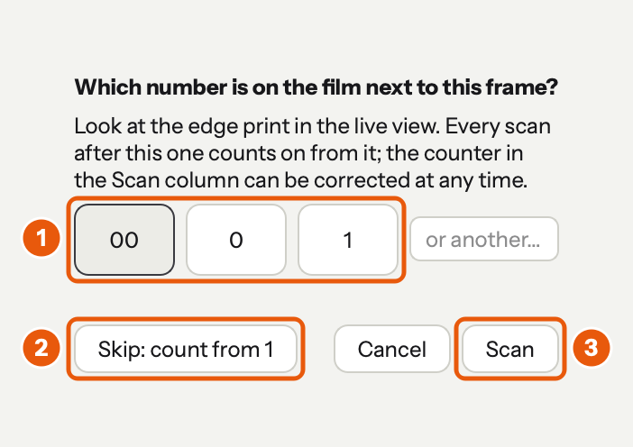
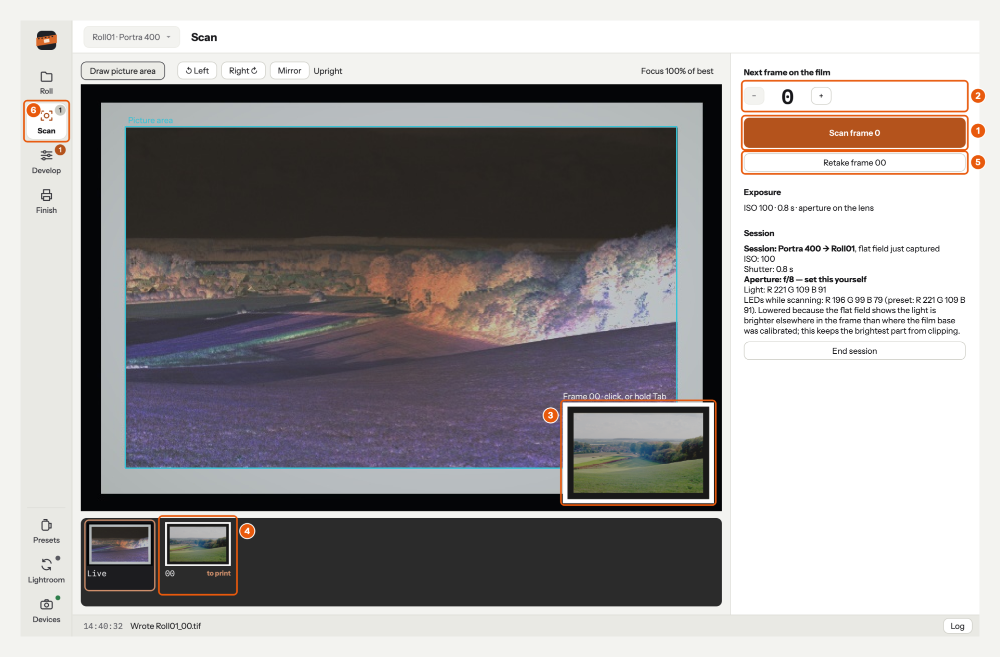
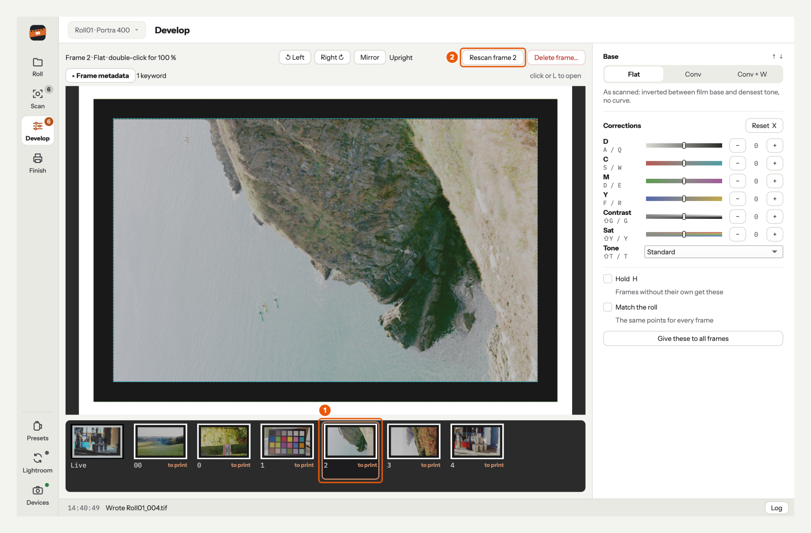
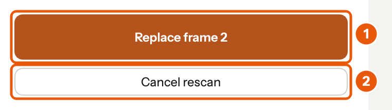

# Scanning

**You need:** a running [session](session.md) and the roll's first strip in the holder.

## 1. Mark the picture area

1. Click **Draw picture area**.
2. Drag over the image, just inside the rebate. Only this area is measured for the inversion; holder
   and sprocket holes would skew it. It stays for the whole roll.
3. **Which way up:** *↺ Left*, *Right ↻* and *Mirror* (keys **Shift+N**, **N**, **M**) turn and
   mirror the live view. Frames scanned from then on are written that way up.

For files that hold only the picture area, tick **Crop files to the picture area** on the Roll page,
under *Files*.

## 2. Scan the first frame

Press **Space**, or click **Scan**. At a roll's first scan TetherInvert asks which number is printed on
the film next to the frame:

1. Click the number on the film's edge (or type another, such as *12*).
2. **Skip** counts from 1.
3. Click **Scan**.

Frames are numbered as on the film, and the files are named after it: `Roll01_00.tif` for 00,
`Roll01_000.tif` for 0, `Roll01_001.tif` for 1, so they sort in film order.

## 3. Scan the rest of the roll

1. **Scan frame 0** now; the button always says the number the next frame gets. Advance the film,
   press **Space**, and so on.
2. **Next frame on the film − 0 +** is the same number. Correct it with − and + when you skip a frame.
3. The frame just scanned shows in the corner of the live view for half a minute. Click it to open it on
   Develop, or **hold Tab** to look at it and let go to come back.
4. Every frame appears in the strip. *to print* means it has no up-to-date print yet (see
   [Finishing the roll](finishing.md#prints)).
5. **Retake frame 00** shoots the last frame again, for example after the strip moved.
6. The rail's **Scan** counts the frames scanned.

The live view stays up while the frame is written, so you can go straight on to the next. On the
author's rig a 36-frame roll took 11 minutes, advancing the film by hand included.

## Scanning a frame again

To replace any frame, not just the last:

1. Click the frame in the strip. It opens on Develop.
2. Click **Rescan frame 2**, above the frame. Nothing is shot yet: Scan and the live view come back.
   The button is there during the roll's session only.

1. Put that frame in the holder and click **Replace frame 2** (you are asked once).
2. Or **Cancel rescan**.

The frame keeps its number, base, corrections and metadata. In Lightroom the file keeps its catalog
entry and its edits, and shows the new picture.

## If a frame is clipped

After each frame TetherInvert checks its RAW files. If more than 0.1 % of the picture area hit the
sensor's ceiling in a colour, the log says so **in red**:

- **With a flat field:** the film let more light through than at calibration. Check the f-stop ring;
  or the strip is thinner than the one you calibrated on.
- **Without one:** more likely the light is brighter somewhere in the frame than where the film base
  was metered. Capture a flat field.

Clipped parts of the negative (its thinnest, the picture's shadows) come out as crushed shadows, and no
render brings them back.
Rescan the frame after fixing the cause.

## More

- **Delete frame…** (above a frame on Develop, or the Delete key) deletes it with all its files, after
  asking. The other frames keep their numbers.
- **Also save the linear negative** (on the Roll page, under *Files*) keeps the merged image, not
  inverted, in `negative/`.
- **Render roll again** and **Delete RAW files…** are on Finish: see
  [The roll's files](finishing.md#the-rolls-files).
- **End session** when the roll is done.

**Next:** [develop](developing.md) the frames.
