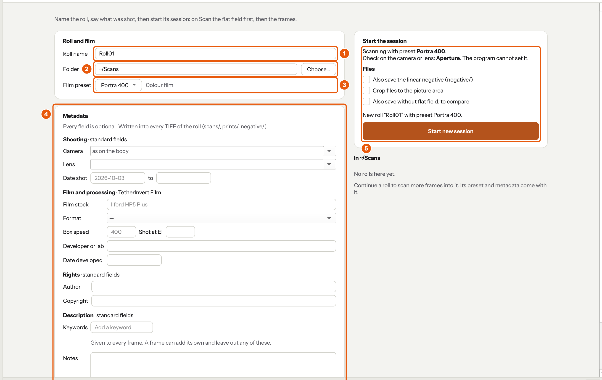
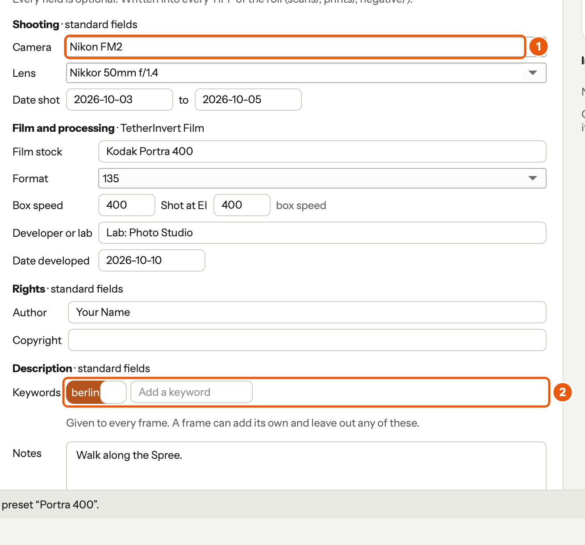
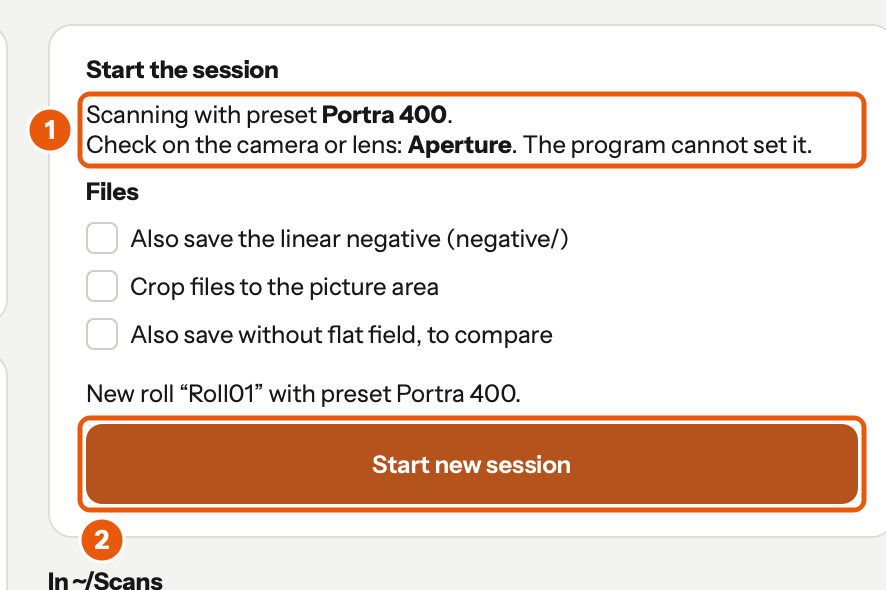
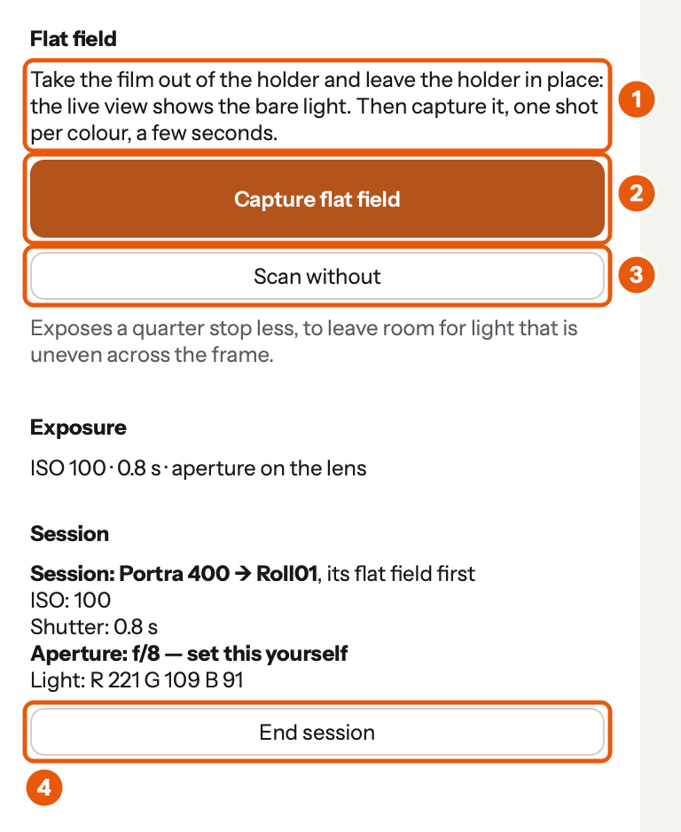
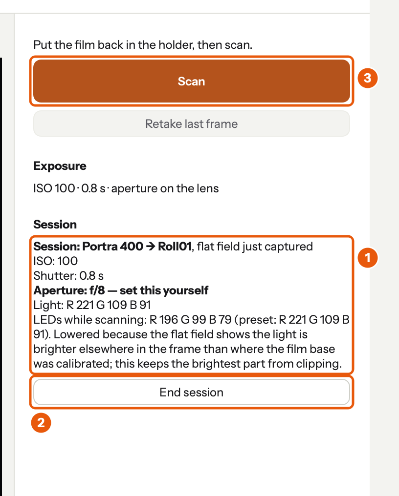
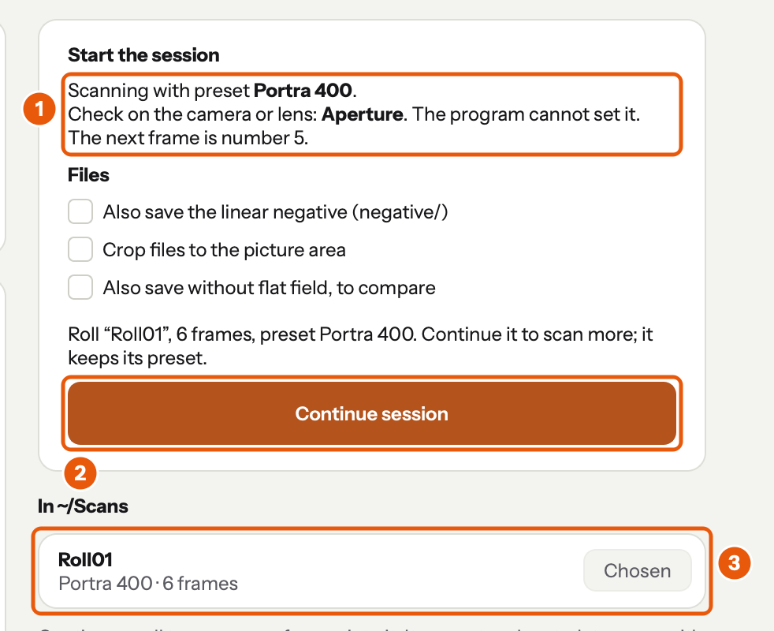
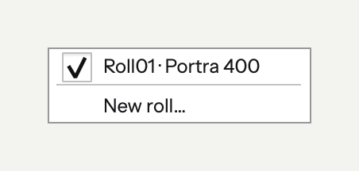

# Starting a session

A session is scanning one roll. It starts on the **Roll** page with the roll's name and its metadata;
its first step on **Scan** is the flat field.

**You need:** a calibrated [film preset](calibrating.md) for the film, the roll's strips at hand, and
the holder on the light.

## 1. Name the roll and choose its preset

Open **Roll** in the rail.

1. **Roll name**: a name no folder there has yet: *Roll01*, *2026-10 Berlin*. It becomes the roll's
   folder and the start of every file name.
2. **Folder**: where your rolls are kept, for example `~/Scans`. *Choose…* picks it.
3. **Film preset**: the film's preset. The list also has **New preset…**, which calibrates one, and
   **Manage presets**, which opens Presets.
4. **Metadata**: what was shot, and on what (next step).
5. **Start the session**: what to set by hand, the options for the files, and the button.

The rolls already in the folder are listed under *Start the session*, each with **Continue** (see
[Continuing a roll](#continuing-a-roll)).

## 2. Fill in the roll's metadata

1. **Camera** and the other fields: everything is optional. Camera and lens offer what you typed before.
2. **Keywords**: Enter or a comma adds one.

What you fill in goes into every file of the roll, and the camera, film and dates appear on the
contact sheet. A new roll's fields are kept until its session starts, and written then. See
[Metadata](metadata.md) for every field.

## 3. Start the session

1. What to set on the camera or lens by hand (here the aperture). **Set it.**
2. **Start new session**. The line above the button says what will happen: a new roll, or an
   existing one to continue.

The window opens **Scan**. Nothing is shot yet.

## 4. The flat field

The session's first step, beside the live view:

1. **Take the film out of the holder** and leave the holder in place. The live view shows the bare
   light.
2. **Capture flat field** (or Space). TetherInvert photographs the bare light, one shot per colour.
   This takes a few seconds; the first session with a new preset may take a few more shots. If film is
   still in the holder, the capture is refused, the step says why, and you can capture again.
3. Or **Scan without**. TetherInvert then exposes a quarter stop less, to leave room for uneven light. A
   flat field is better: see [why](concepts.md#3-a-flat-field-per-session).
4. **End session** leaves it; the roll can be continued any time.

A roll that has a flat field this preset can use offers a third way: **Keep the flat field from …**, if
holder, light and focus are as they were.

## 5. The session is running

1. The session text repeats the settings, and says when the light was lowered after the flat field
   (the brighter middle of the frame would clip otherwise).
2. **End session** ends it. The roll stays as it is and can be continued any time.
3. **Scan** is ready. Above it, a reminder to **put the film back in the holder**, until the first frame.

During a session the roll and its preset can't be changed: the Roll page's fields and the roll picker
stay on the session's roll. The film base rectangle is hidden.

**Next:** [scan](scanning.md).

## Continuing a roll

On **Roll**, click **Continue** beside the roll in the folder's list. Its name, preset and metadata
come into the page, and the button reads **Continue session**.

1. What it continues: the roll's own preset, and the number the next frame gets.
2. **Continue session**. On Scan the flat field comes first, as for a new roll: **Keep the flat field**
   if holder, light and focus are as they were, **Capture flat field** if anything moved, or **Scan
   without**.
3. The rolls in the folder; the one on the page reads *Chosen*.

Numbering carries on. A roll always continues with its own copy of its preset, even if that preset
has been recalibrated since.

**Continue session** is on **Scan** too, where **End session** was: pick the roll with the roll
picker, continue, and settle its flat field. For a roll not started yet, Scan's button reads **New
roll on Roll…** and opens Roll, where the roll gets its preset and metadata.

The roll picker at the top of the window lists the folder's rolls and **New roll…**:

## Seeing what the flat field does

Tick **Also save without flat field, to compare** on the Roll page before scanning. Every file is
then written twice, `scans/Roll01_001.tif` with the flat field and `scans/Roll01_001_noflat.tif`
without, from the same exposures. Stack the pair in Lightroom and flip between them.
