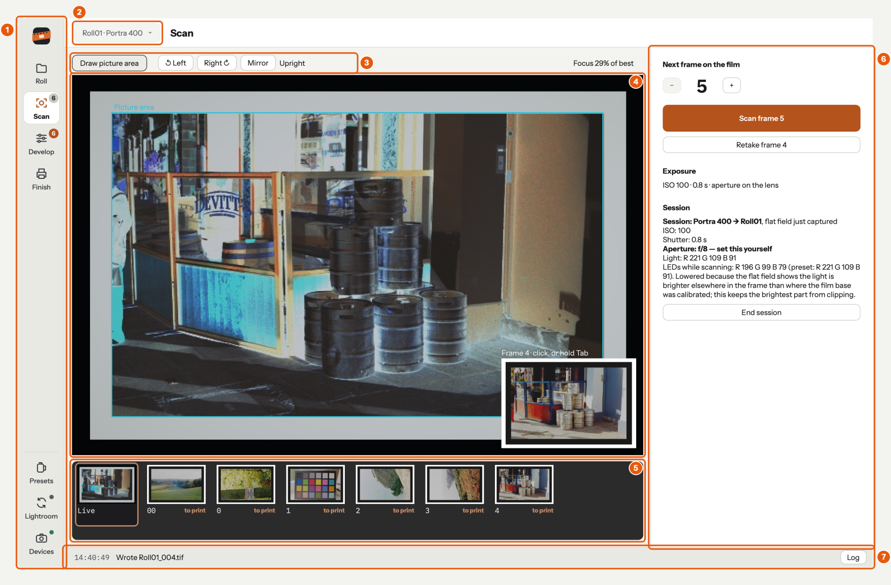
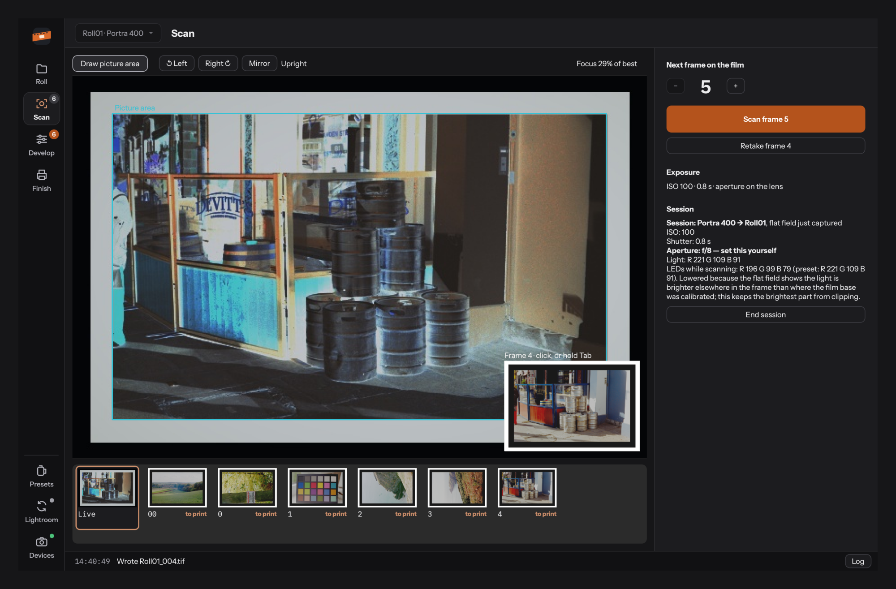
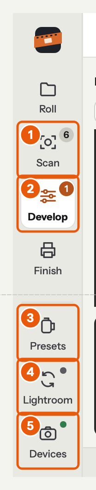
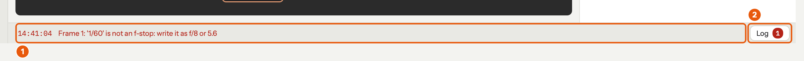
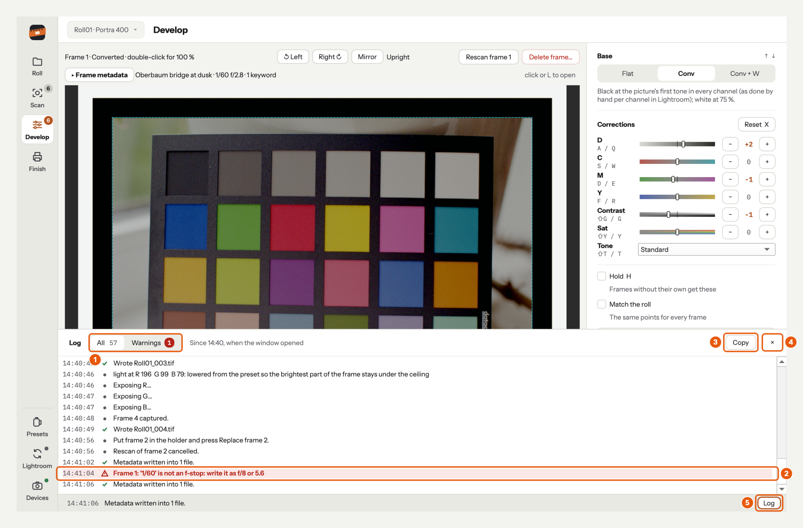
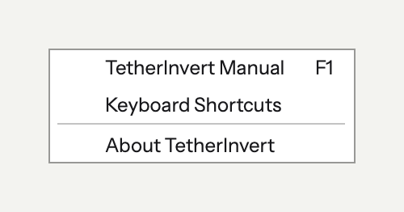
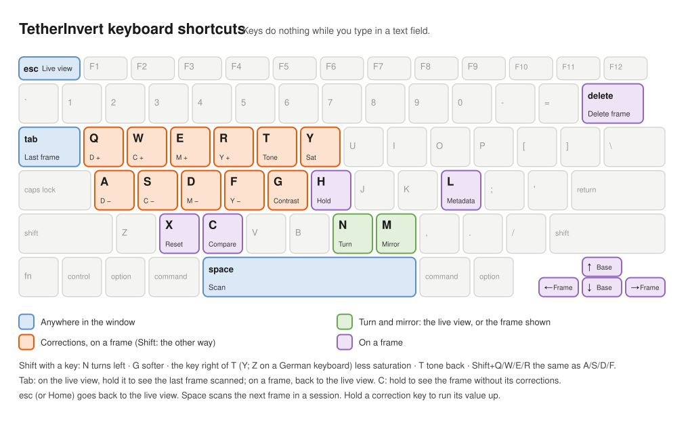

# The window

Everything happens in one window. Open it from the app, or with `tetherinvert gui`.

| | Part | What it is for |
|---|---|---|
| **1** | Rail | The steps of a roll, and at its foot Presets, Lightroom and the devices (below). |
| **2** | Roll picker | The roll you are working on, with its preset: *Roll01 · Portra 400*. Switches to another roll in the folder, or to a new one. |
| **3** | Live view tools | *Draw picture area*, and turning or mirroring what the camera sees. While calibrating also *Draw film base*. |
| **4** | Live view | What the camera sees, under a dim framing light. The frame just scanned shows in its corner. |
| **5** | Strip | *Live*, then every frame of the roll. Click a frame to develop it. |
| **6** | The step's column | Here Scan's: the next frame's number, *Scan*, the exposure and the session. Develop has its corrections here. |
| **7** | Status bar | The last thing that happened, with its time, and **Log**. |

The window follows your system's appearance, light or dark:

## The rail

The steps of every roll, top to bottom. Each can be opened at any time: you can develop a frame
during a session, or go back to Roll.

| Step | What you do there | Page |
|---|---|---|
| **Roll** | Name the roll, fill in its metadata, start or continue its session | [Starting a session](session.md) |
| **Scan** | Scan the frames | [Scanning](scanning.md) |
| **Develop** | A frame large, its base and corrections | [Developing](developing.md) |
| **Finish** | Prints, the contact sheet, the roll's metadata and files | [Finishing the roll](finishing.md) |

1. **Scan**'s count is the number of frames scanned.
2. **Develop**'s count, in orange, is the number of frames due for a print. No count: every print is
   up to date.

At the foot, what you need now and then:

3. **Presets**: your film presets, and calibrating a new one ([Calibrating](calibrating.md)).
4. **Lightroom**: opens the roll in Lightroom Classic ([Lightroom Classic](lightroom.md)). Its dot is
   green while Lightroom watches the roll's folders, grey otherwise.
5. **Devices**: camera and light ([Your rig](rig.md#the-window)). Its dot is green when both are
   connected and red when one is missing, wherever they are needed: on Roll and Scan, while
   calibrating, and on every step during a session. On Develop, Finish and the list of presets, which
   need neither, it is grey.

## The roll picker

The button above every step but Presets (**2** in the first picture) lists the rolls in the folder,
each with its preset, and **New roll…** (the first free name, on Roll). Picking one switches every
step to that roll; you stay on the step you are on. During a session it stays on the session's roll. See
[Continuing a roll](session.md#continuing-a-roll).

## Moving around

- **Click a frame** in the strip to develop it: Develop opens.
- **← / →** go to the previous and next frame, **↑ / ↓** through the frame's bases.
- **Esc** or **Home** goes back to the live view on Scan. While calibrating it stays on Presets,
  where the live view is.
- **Space** scans the next frame from any step while a session runs; Scan opens to show it.
- **Hold Tab** to look at the frame just scanned; let go to come back.

## The log

The status bar shows the last line, with its time. **Log** opens every line since the window opened,
over the bottom of the page.

1. A warning turns the line red for eight seconds, or until a line that is not a warning follows it.
2. **Log** keeps a red count of the warnings you have not seen, until you open it.

1. **All** or only the **Warnings**, each with how many there are.
2. A warning: in red, with a triangle. A file written has a tick.
3. **Copy** puts the lines shown on the clipboard, with their times: paste them into an issue when
   you report a problem.
4. **×** closes it.
5. So does **Log**, which is outlined while the log is open. It stays open while you work: Space still
   scans, Esc still goes to the live view.

Lines can be selected with the mouse and copied with ⌘C, too. The log keeps the last 1000 lines.

## The Help menu

- **TetherInvert Manual** (⌘? on a Mac) opens this manual in your web browser.
- **Keyboard Shortcuts** opens the drawing below in a window of its own, to keep beside the main one.
- **About TetherInvert** shows the version and the build, and what TetherInvert runs on (system, Python, Qt,
  camera library, RAW decoder). **Copy details** puts all of it on the clipboard: paste it into an
  issue when you report a problem. On a Mac, About is in the **TetherInvert** menu, next to the Apple menu.

## Keyboard shortcuts

Blue keys work anywhere in the window, green ones turn and mirror what is shown, orange and purple ones
work on a frame you have opened. None of them work while you are typing in a text field.
